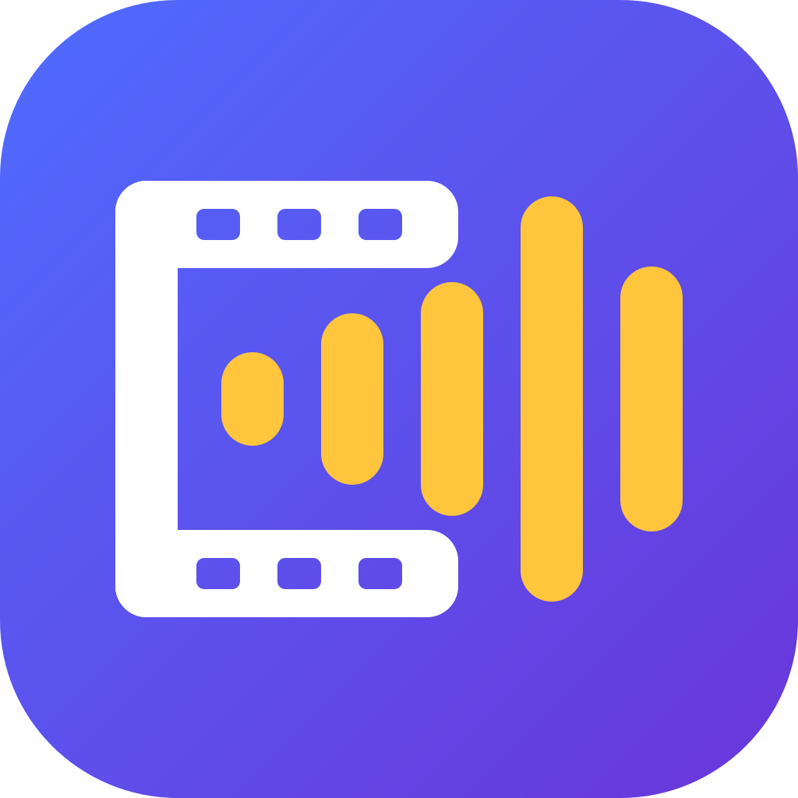
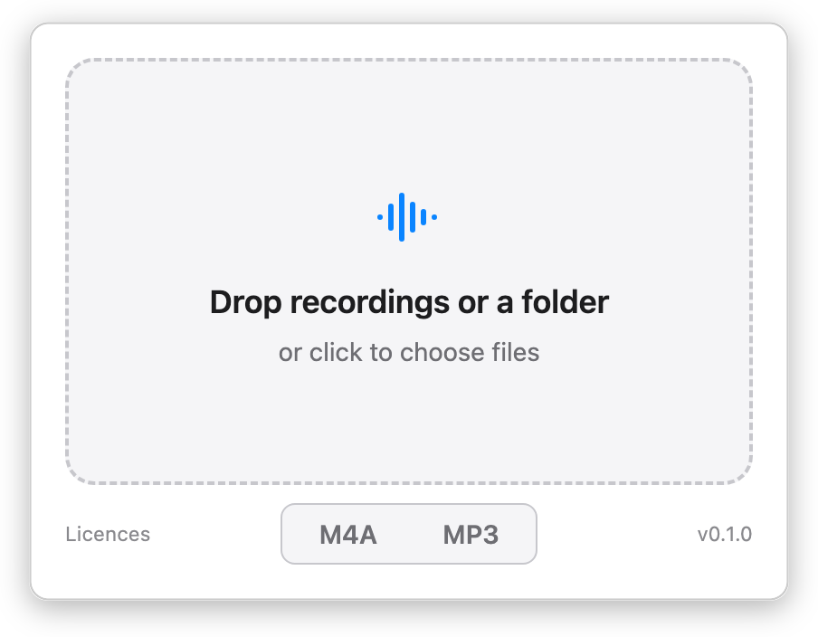
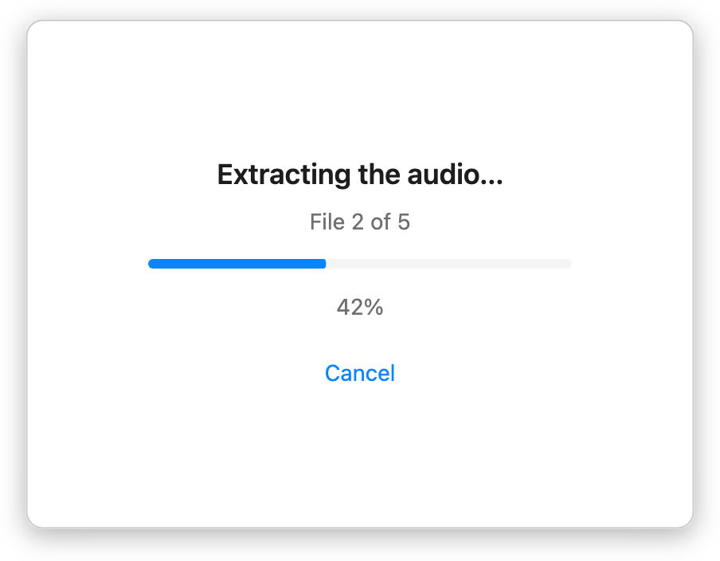
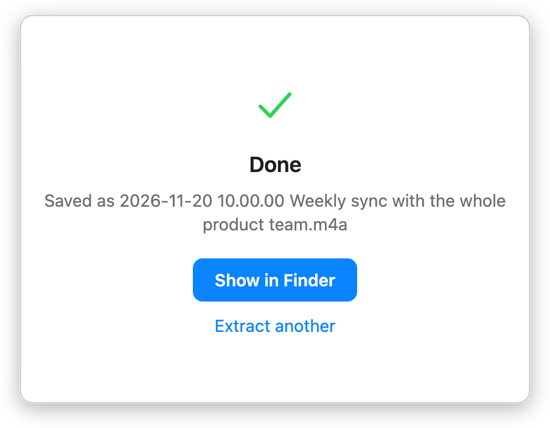
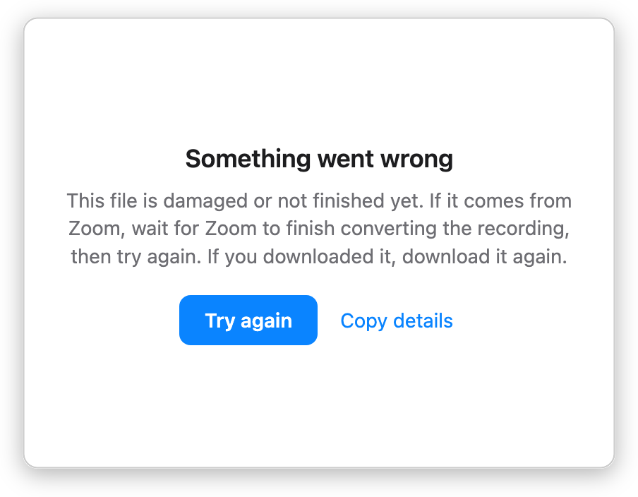
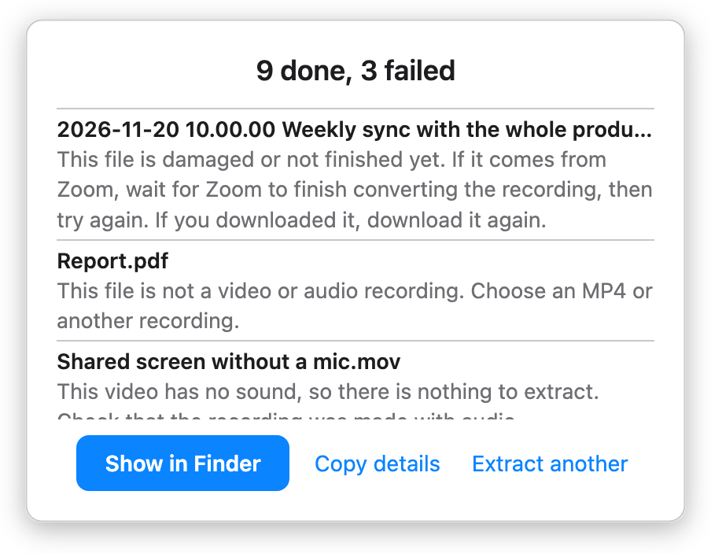

<p align="center">
  
</p>

<h1 align="center">AudioExtractor</h1>

<p align="center">
  Drop a Zoom recording on the window, get its audio as M4A or MP3.<br>
  A tiny desktop app for macOS and Windows, in English and French.
</p>

<p align="center">
  <a href="https://github.com/motdiem/AudioExtractor/releases/latest">Download</a> ·
  <a href="ARCHITECTURE.md">Architecture</a> ·
  <a href="docs/tutorial/README.md">Tutorial</a>
</p>

---

## How it looks

Drop a recording, wait a moment, and it's saved:

<table>
  <tr>
    <td align="center" valign="top" width="33%">
      <picture>
        <source media="(prefers-color-scheme: dark)" srcset="docs/screenshots/idle-dark.png">
        
      </picture>
      <br><sub><b>1.</b> Drop recordings or a folder, or click to choose</sub>
    </td>
    <td align="center" valign="top" width="33%">
      <picture>
        <source media="(prefers-color-scheme: dark)" srcset="docs/screenshots/working-dark.png">
        
      </picture>
      <br><sub><b>2.</b> Progress, only for jobs that take a while</sub>
    </td>
    <td align="center" valign="top" width="33%">
      <picture>
        <source media="(prefers-color-scheme: dark)" srcset="docs/screenshots/done-dark.png">
        
      </picture>
      <br><sub><b>3.</b> Done, named after the Zoom meeting</sub>
    </td>
  </tr>
  <tr>
    <td align="center" valign="top">
      <picture>
        <source media="(prefers-color-scheme: dark)" srcset="docs/screenshots/error-dark.png">
        
      </picture>
      <br><sub>An error, in plain words</sub>
    </td>
    <td align="center" valign="top">
      <picture>
        <source media="(prefers-color-scheme: dark)" srcset="docs/screenshots/summary-dark.png">
        
      </picture>
      <br><sub>A batch summary</sub>
    </td>
    <td></td>
  </tr>
</table>

The screenshots follow your light or dark theme, like the app does.

## What it does

- **Drop and done.** Drop a video (or click to pick one), choose where to save, and the audio is out. M4A is a straight copy of the audio track, so it takes about a second; MP3 is encoded at 128 kbps, with a progress bar and a Cancel button.
- **Batches and folders.** Drop several recordings or a whole folder and get one audio file per recording, with Zoom's generic `video1234567890.mp4` names turned into the meeting's name.
- **Errors people understand.** "This video has no sound", "This file is damaged or not finished yet", "A file with that name is open in another program": one plain sentence in English or French, and a **Copy details** button with the technical log for whoever helps.
- **Works from anywhere.** Drop files on the Dock icon or the `.exe`, or use "Open with". No installer, no admin rights, and nothing leaves the computer.
- **Small and self-contained.** A slim, LGPL-only ffmpeg is built in. The Mac app is universal (Apple Silicon and Intel); Windows is a single exe for Windows 10 and 11.

## Download

Get the latest zip from the [releases page](https://github.com/motdiem/AudioExtractor/releases/latest):

| | File | First launch |
| --- | --- | --- |
| macOS 12+ | `AudioExtractor-mac.zip` | [notes](docs/first-launch/mac/README-EN.txt) ([en français](docs/first-launch/mac/LISEZ-MOI-FR.txt)) |
| Windows 10/11 | `AudioExtractor-windows.zip` | [notes](docs/first-launch/windows/README-EN.txt) ([en français](docs/first-launch/windows/LISEZ-MOI-FR.txt)) |

The apps are not signed with a paid certificate, so macOS Gatekeeper and Windows SmartScreen warn on first launch. The notes inside each zip explain the two clicks to get past it.

## Build it yourself

Everything builds on one Mac, with no CI. You need Go 1.27, Node, the Xcode command line tools and Homebrew, plus the Wails CLI:

```bash
go install github.com/wailsapp/wails/v3/cmd/wails3@v3.1.0
```

Run the app in development mode, with hot reload:

```bash
wails3 task dev
```

Build both releases (the universal `.app`, the Windows `.exe`, both zips and checksums) into `dist/`:

```bash
wails3 task release
```

The first release build also compiles ffmpeg for both platforms from pinned sources, which needs `brew install mingw-w64 nasm pkg-config` and takes a few minutes. [Chapter 1](docs/tutorial/01-scaffold-and-local-builds.md) of the tutorial walks through the setup and its pitfalls.

Run the tests (they use a real ffmpeg on your `PATH`, or the one in `$AUDIOEXTRACTOR_FFMPEG`):

```bash
go test ./...
```

```bash
cd frontend && npm run check
```

Before sending a release out, go through the [release checklist](docs/manual-test-checklist.md).

The screenshots above come from the frontend's dev-only screen previews, so they need no Go side and no real files. After a UI change, regenerate them (light and dark) with Google Chrome and ImageMagick installed:

```bash
bash scripts/screenshots/capture.sh
```

## How it works

A Go backend on [Wails v3](https://v3.wails.io/) with a plain TypeScript window. One Go service owns all the behaviour; the window only shows its state; ffmpeg runs as a separate process, embedded in the binary and unpacked to the user cache on first use. [ARCHITECTURE.md](ARCHITECTURE.md) has the full map: the packages, the life of a job, the test seams and the platform differences.

## Tutorial

The app was built ticket by ticket, and each ticket became a chapter: what we did, why, the exact commands and the pitfalls. Start at the [tutorial index](docs/tutorial/README.md) or jump straight to a chapter.

| # | Chapter | In short |
| --- | --- | --- |
| 1 | [Scaffold and local builds](docs/tutorial/01-scaffold-and-local-builds.md) | A Wails v3 app and a one-command release for both OSes from a Mac |
| 2 | [A slim ffmpeg for macOS](docs/tutorial/02-slim-ffmpeg-for-macos.md) | A 6 MB universal, LGPL-only ffmpeg, embedded with `go:embed` |
| 3 | [Cross-compiling ffmpeg for Windows](docs/tutorial/03-cross-compiling-ffmpeg-for-windows.md) | A static `ffmpeg.exe` built with mingw-w64, tested in a VM |
| 4 | [First extraction: MP4 to M4A](docs/tutorial/04-first-extraction-m4a.md) | The extraction service, its test seam, file drop and EN/FR |
| 5 | [MP3, progress and Cancel](docs/tutorial/05-mp3-progress-cancel.md) | LAME, ffmpeg's progress output, clean cancel, a settings store |
| 6 | [Errors people understand](docs/tutorial/06-errors-people-understand.md) | Classifying failures and a Copy details button |
| 7 | [Batches, folders and Zoom names](docs/tutorial/07-batches-and-zoom-names.md) | Folder drops, collision suffixes, meeting names, a summary |
| 8 | [Launch with files](docs/tutorial/08-launch-with-files.md) | Dock and exe drops, "Open with", a single instance |
| 9 | [Window polish and a custom icon](docs/tutorial/09-window-polish-and-icon.md) | The icon, light/dark, a remembered window position, the version |
| 10 | [Testing on Windows from a Mac](docs/tutorial/10-testing-windows-from-a-mac.md) | Driving the real exe in a Parallels VM with UI Automation |
| 11 | [Hardening from a code review](docs/tutorial/11-hardening-from-a-code-review.md) | Eight bugs hiding behind green tests, and their fixes |
| 12 | [Shipping it](docs/tutorial/12-shipping-it.md) | LGPL obligations, the release task and first-launch notes |

## Licence

AudioExtractor's own code is under the [MIT licence](LICENSE). Release builds bundle ffmpeg and LAME, which are under the LGPL; see [THIRD_PARTY_NOTICES.txt](THIRD_PARTY_NOTICES.txt) and [`third_party/licenses/`](third_party/licenses).
